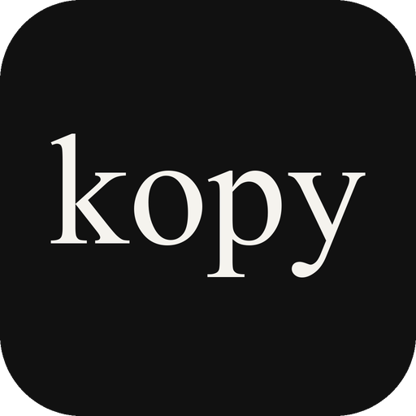

<p align="center">
  
</p>

<h1 align="center">kopy</h1>
<p align="center"><b>한국어로 쓰는 파이썬</b><br><a href="https://ssayuz.github.io/kopy/">홈페이지</a> · <a href="https://github.com/ssayuz/kopy/releases/latest/download/kopy-setup.exe">설치 파일 받기</a></p>

```
함수 피보나치(n):
    만약 n < 2:
        반환 n
    반환 피보나치(n - 1) + 피보나치(n - 2)

반복 i 안에 범위(10):
    출력(피보나치(i))
```

kopy는 한국어 키워드로 쓴 코드를 파이썬으로 바꿔서 실행합니다.
파이썬 문법을 그대로 따르기 때문에 파이썬 라이브러리도 전부 쓸 수 있어요.

## 설치

**방법 1 — 설치 파일 (Windows, 파이썬 필요 없음)**

[Releases](https://github.com/ssayuz/kopy/releases)에서 `kopy-setup.exe`를 받아 실행하세요.

- `.kopy` 파일을 더블클릭하면 실행돼요. 편집은 우클릭 → 편집(메모장)
- 새로 연 터미널 어디서든 `kopy` 명령어 사용
- 제거: 설정 → 앱 → "kopy (한국어 파이썬)" → 제거
- 서명되지 않은 exe라서 Windows가 경고하면 "추가 정보 → 실행"을 누르세요.

**방법 2 — pip (파이썬 3.8 이상)**

```
git clone https://github.com/ssayuz/kopy.git
cd kopy
pip install .
```

## kopy 편집기

파이썬의 IDLE처럼 코드를 쓰고 바로 실행하는 프로그램이에요.
설치하면 시작 메뉴와 바탕 화면에 **kopy 편집기**가 생겨요.

- 키워드·문자열·주석 색칠, 줄 번호, 자동 들여쓰기
- **F5**로 실행, 결과는 아래 출력 창에. `입력()`은 아래 입력 칸에 써요
- 오류는 빨간색으로, 프로그램 중지(Ctrl+F2), 키워드 표, 파이썬으로 바뀐 코드 보기
- `.kopy` 파일 우클릭 → **kopy 편집기로 편집**

직접 실행: 설치 폴더의 `kopy 편집기.exe`, 또는 `python src/kopy_ide.py 파일.kopy`

## 실행

`kopy`는 `python` 명령어와 똑같이 쓸 수 있어요.

```
kopy 안녕.kopy 인자1 인자2   # 실행 (인자는 sys.argv 로)
kopy                         # 대화형 모드
kopy -c "출력(1 + 2)"        # 명령 실행
kopy -m 도구                 # 모듈 실행 (도구.kopy 또는 파이썬 모듈)
kopy -i 안녕.kopy            # 실행 후 대화형 모드
kopy -m pip install requests # 패키지 설치
kopy -V                      # 버전
kopy --변환 안녕.kopy        # 파이썬으로 바뀐 코드 보기
```

- **표준 라이브러리 전부** 사용 가능: json, tkinter, sqlite3, turtle, asyncio, urllib …
- **다른 .kopy 파일 가져오기**: 같은 폴더의 `도구.kopy`는 `가져오기 도구`로 불러와요.
- `만약 __이름__ == "__main__":` 으로 직접 실행할 때만 도는 코드도 쓸 수 있어요.
- 오류는 파이썬처럼 추적과 함께 한국어로 보여줘요.

```
오류 추적 (가장 최근 호출이 마지막):
  파일 "오류.kopy", 2번째 줄, 나누기 안에서
    반환 가 / 나
영나누기오류: 0으로 나눌 수 없어요
```

설치판에서 `kopy -m pip install`로 받은 패키지는 `%APPDATA%\kopy\site-packages`에 들어가요.

## 예제

| 파일 | 내용 |
|---|---|
| [안녕.kopy](예제/안녕.kopy) | 출력, 조건문, 반복문 |
| [구구단.kopy](예제/구구단.kopy) | 중첩 반복문 |
| [별찍기.kopy](예제/별찍기.kopy) | 함수로 삼각형·피라미드·다이아몬드 |
| [소수.kopy](예제/소수.kopy) | 리스트 내포 |
| [피즈버즈.kopy](예제/피즈버즈.kopy) | FizzBuzz |
| [성적표.kopy](예제/성적표.kopy) | 사전, 람다 |
| [할일목록.kopy](예제/할일목록.kopy) | 클래스 |
| [계산기.kopy](예제/계산기.kopy) | 입력, 예외 처리 |
| [숫자맞히기.kopy](예제/숫자맞히기.kopy) | 게임, 모듈 가져오기 |
| [종합.kopy](예제/종합.kopy) | 여러 기능 한눈에 |

## 키워드

| kopy | 파이썬 | kopy | 파이썬 |
|---|---|---|---|
| 만약 | if | 함수 | def |
| 아니면 만약 / 아니면만약 | elif | 반환 | return |
| 아니면 | else | 클래스 | class |
| 반복 … 안에 | for … in | 참 / 거짓 / 없음 | True / False / None |
| 동안 | while | 그리고 / 또는 / 아님 | and / or / not |
| 중단 / 계속 / 통과 | break / continue / pass | 이다 | is |
| 시도 / 예외 / 마침내 | try / except / finally | 발생 | raise |
| 가져오기 / 부터 / 로서 | import / from / as | 함께 | with |
| 람다 | lambda | 양보 | yield |

## 내장 함수

출력(print), 입력(input), 범위(range), 길이(len), 정수(int), 실수(float), 문자열(str),
목록(list), 사전(dict), 집합(set), 합계(sum), 최대(max), 최소(min), 정렬(sorted),
뒤집기(reversed), 절댓값(abs), 반올림(round), 자료형(type), 열거(enumerate), 묶기(zip), 열기(open)

클래스: `자기`(self), `생성자`(`__init__`), `문자표현`(`__str__`)

메서드(점 뒤): `.추가`(append), `.꺼내기`(pop), `.제거`(remove), `.나누기`(split),
`.합치기`(join), `.바꾸기`(replace), `.다듬기`(strip), `.대문자`(upper), `.항목들`(items) 등

예외: 오류(Exception), 값오류, 형오류, 인덱스오류, 키오류, 영나누기오류 등

전체 목록은 [src/kopy.py](src/kopy.py) 맨 위에 있어요. 파이썬 영어 키워드도 그대로 섞어 쓸 수 있습니다.

## 직접 빌드하기

```
python -m pip install pyinstaller pillow
python logo/make_logo.py                          # 로고·아이콘 (선택)
powershell -ExecutionPolicy Bypass -File 설치파일만들기/build.ps1  # → dist/kopy-setup.exe
```

## 폴더 구조

**설치하면** (`%LOCALAPPDATA%\Programs\kopy`)

```
kopy\
├─ kopy 편집기.exe   ← 코드를 쓰고 실행하는 프로그램 (바탕 화면 바로 가기와 같아요)
├─ kopy.exe          ← 터미널에서 쓰는 kopy 명령어
└─ 예제\             ← 예제 코드
```

실행에 필요한 나머지 파일은 숨긴 `_internal` 폴더에 들어 있어요.

**이 저장소는**

```
kopy/
├─ 예제/             ← 예제 코드 (.kopy)
├─ src/
│  ├─ kopy.py        ← kopy 언어 (한국어 → 파이썬 번역 + 실행)
│  └─ kopy_ide.py    ← kopy 편집기
├─ 설치파일만들기/   ← kopy-setup.exe 를 만드는 스크립트
├─ logo/             ← 로고와 아이콘
└─ README.md
```

## 라이선스

[MIT](LICENSE) © 2026 이윤재 (ssayuz)
